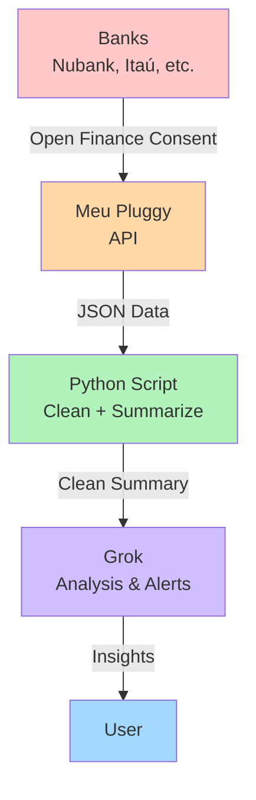

# grok-finance

[](https://opensource.org/licenses/MIT)
[](https://www.python.org/downloads/)
[](https://openfinancebrasil.org.br/)

> Personal finance control using **Grok** + **Open Finance** (via Meu Pluggy).

A lightweight Python tool that fetches your bank data through Open Finance, generates a clean summary, and prepares it for analysis with Grok.

---

## Overview

**grok-finance** bridges your Brazilian bank accounts and Grok:

1. Connect your banks via **Meu Pluggy** (free for personal use)
2. A Python script fetches, cleans, and summarizes transactions
3. The summary is ready to be analyzed by Grok (projections, alerts, insights)

Designed for personal use with 1–5 bank accounts, without regulatory complexity.

## Architecture



## Features

- Authentication with Meu Pluggy API
- List connected accounts and balances
- Fetch transactions for a given period
- Generate a concise, Grok-ready summary
- Privacy-focused (only summaries leave your environment)

## Prerequisites

- Python 3.10 or higher
- A [Meu Pluggy](https://pluggy.ai/meu-pluggy) account with your banks already connected
- API credentials (`clientId` and `clientSecret`) from the Pluggy dashboard

## Installation

```bash
git clone https://github.com/filipejesse/grok-finance.git
cd grok-finance
python -m venv venv
source venv/bin/activate          # On Windows: venv\Scripts\activate
pip install -r requirements.txt
```

Copy `.env.example` to `.env` and fill it in:

```env
PLUGGY_CLIENT_ID=your_client_id
PLUGGY_CLIENT_SECRET=your_client_secret
PLUGGY_ITEM_IDS=item-id-bank-1,item-id-bank-2
```

The Pluggy API has no endpoint to list your connections, so copy the **item ID** of each connected bank from the Meu Pluggy dashboard.

Personal rules (salary/rent days, keyword categories, atypical-transaction thresholds, transfers to ignore) live in `config.py`.

## Usage

```bash
python cli.py           # print the summary
python cli.py --save    # also write output/resumo-YYYY-MM.txt and .json
python cli.py --email   # also e-mail it (needs GMAIL_* in .env)
```

It fetches the current month plus the previous one (`PREVIOUS_MONTHS` in `config.py`). Card bill payments and transfers between your own accounts are excluded from the totals to avoid double counting.

The script outputs a summary like:

```text
=== FINANCIAL SUMMARY - MONTH/YEAR ===
Accounts:
- Nubank: R$ X,XXX.XX
- Itaú: R$ X,XXX.XX

Period Movement:
- Inflows: R$ X,XXX.XX
- Outflows: R$ X,XXX.XX
- Net: R$ X,XXX.XX

Top Categories:
1. Housing: R$ X,XXX
2. Food: R$ X,XXX
...

Notable Transactions:
- [date] Description - R$ XXX
```

Paste the output into Grok and ask for analysis, projections, or alerts.

## Cloud deployment (Firebase)

`main.py` is a scheduled Cloud Function (Python 3.12, `southamerica-east1`) that e-mails the summary every Monday at 08:00 (São Paulo). Change `CLOUD_SCHEDULE` in `config.py` to adjust.

Every push to `master` deploys through GitHub Actions (`.github/workflows/deploy.yml`):

1. Tests run.
2. The workflow authenticates to Google Cloud with Workload Identity Federation (no key stored in GitHub).
3. GitHub secrets are copied to Google Secret Manager, the function is deployed and old secret versions are destroyed.

Required **GitHub secrets**: `PLUGGY_CLIENT_ID`, `PLUGGY_CLIENT_SECRET`, `PLUGGY_ITEM_IDS`, `GMAIL_ADDRESS`, `GMAIL_APP_PASSWORD` ([Gmail app password](https://myaccount.google.com/apppasswords), needs 2-step verification).
Required **GitHub variables**: `GCP_WORKLOAD_IDENTITY_PROVIDER`, `GCP_SERVICE_ACCOUNT`.

The summary is never written to logs. The workflow never runs the report, because Actions logs are public on public repositories.

## Project Structure

```
grok-finance/
├── .env.example
├── requirements.txt
├── cli.py               # local entry point
├── main.py              # Cloud Function entry point
├── report.py            # fetch + summarize (shared)
├── emailer.py           # Gmail SMTP
├── pluggy_client.py     # authentication + API calls
├── processor.py         # cleaning, categorization and summary
├── config.py            # fixed rules and personal context
├── firebase.json
├── .github/workflows/deploy.yml
└── tests/
```

Run the tests with `python -m unittest`.

## Security

- Never commit your `.env` file
- Pluggy tokens can be revoked at any time from the dashboard
- Run the script only in an environment you control
- Only summaries (never raw transaction data) should be sent to Grok

## Roadmap

- [ ] Automatic sending of summaries to Grok API
- [ ] Scheduled runs (Cloud Function / cron)
- [ ] Smarter transaction categorization
- [ ] Multi-period support
- [ ] Monthly reports

## Contributing

Contributions are welcome!

1. Fork the repository
2. Create your feature branch (`git checkout -b feature/amazing-feature`)
3. Commit your changes (`git commit -m 'Add some amazing feature'`)
4. Push to the branch (`git push origin feature/amazing-feature`)
5. Open a Pull Request

Please make sure to update tests as appropriate.

## License

This project is licensed under the MIT License - see the [LICENSE](LICENSE) file for details.

## Disclaimer

This is a personal-use tool. It is **not** a regulated financial product. Use at your own risk. The authors are not responsible for any financial decisions made based on the output of this tool.

---

Made with ❤️ for better personal finance visibility.
