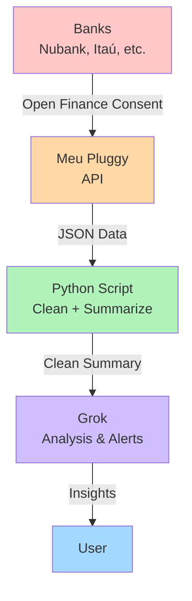
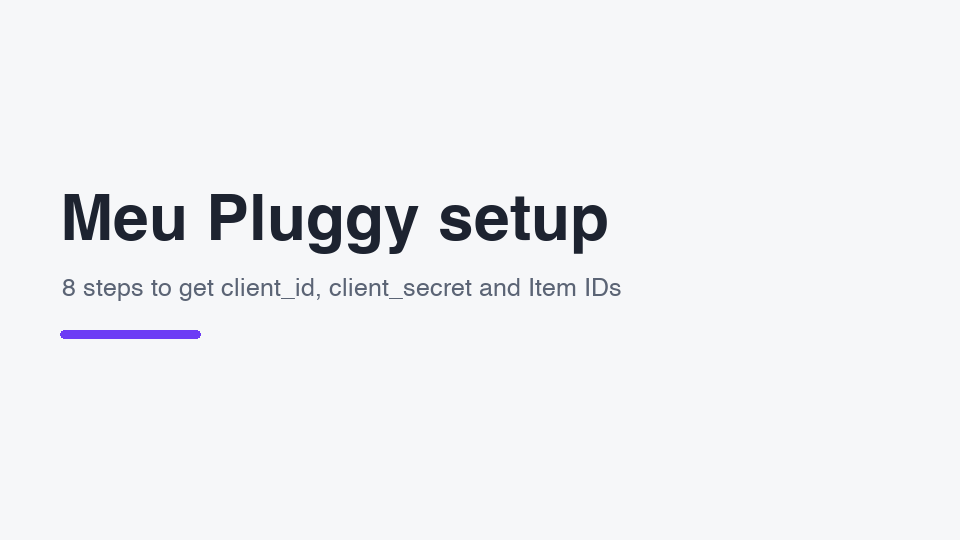

# grok-finance

[](https://opensource.org/licenses/MIT)
[](https://www.python.org/downloads/)
[](https://openfinancebrasil.org.br/)

> Personal finance control using **Grok** + **Open Finance** (via Meu Pluggy).

A lightweight Python tool that fetches your bank data through Open Finance, generates a clean summary, and prepares it for analysis with Grok.

---

## Overview

**grok-finance** bridges your Brazilian bank accounts and Grok:

1. Connect your banks via **Meu Pluggy** (free for personal use)
2. A Python script fetches, cleans, and summarizes transactions
3. The summary is ready to be analyzed by Grok (projections, alerts, insights)

Designed for personal use with 1–5 bank accounts, without regulatory complexity.

## Architecture



## Features

- Authentication with Meu Pluggy API
- List connected accounts and balances
- Fetch transactions for a given period
- Generate a neutral, Grok-ready report (no personal rules baked in)
- Bounded data: only the current month's transactions plus last month's totals are sent

## Prerequisites

- Python 3.10 or higher
- A [Meu Pluggy](https://pluggy.ai/meu-pluggy) account with your banks already connected
- API credentials (`clientId` and `clientSecret`) from the Pluggy dashboard

## Setting up Meu Pluggy



1. Create an account at [meu.pluggy.ai](https://meu.pluggy.ai) (free for personal use).
2. Connect each bank: press the connect button, pick your institution and authorize it via Open Finance.
3. Create a developer account at [dashboard.pluggy.ai](https://dashboard.pluggy.ai). This starts a 15-day trial: finish steps 4–7 before it ends (data keeps flowing afterwards).
4. In your application, customize the connector list so **MeuPluggy** appears in it.
5. Create a **Development Application** and copy its `client_id` and `client_secret`.
6. Click **"Ir para Demo"** and run **"MeuPluggy OAuth Authorization"** once per bank (authorization is per bank, not per account).
7. In the demo app's three-dot menu, use **"Copiar Item ID"** for each connection. The API cannot list them for you.
8. Put the values in `.env` (local) or in the GitHub secrets (cloud): `PLUGGY_CLIENT_ID`, `PLUGGY_CLIENT_SECRET`, `PLUGGY_ITEM_IDS` (comma-separated).

Sources: [official Meu Pluggy guide](https://github.com/pluggyai/meu-pluggy) and [Actual Budget's Pluggy guide](https://actualbudget.org/docs/advanced/bank-sync/pluggyai) (Item ID step). To regenerate the GIF: `pip install Pillow && python docs/make_pluggy_setup_gif.py`.

## Installation

```bash
git clone https://github.com/filipejesse/grok-finance.git
cd grok-finance
python -m venv venv
source venv/bin/activate          # On Windows: venv\Scripts\activate
pip install -r requirements.txt
```

Copy `.env.example` to `.env` and fill it in:

```env
PLUGGY_CLIENT_ID=your_client_id
PLUGGY_CLIENT_SECRET=your_client_secret
PLUGGY_ITEM_IDS=item-id-bank-1,item-id-bank-2
```

The Pluggy API has no endpoint to list your connections, so copy the **Item ID** of each connected bank from the demo app (see [Setting up Meu Pluggy](#setting-up-meu-pluggy)).

`config.py` only holds credentials and runtime settings (schedule, region, months fetched). No personal finance rules live in the code.

## Usage

```bash
python cli.py           # print the summary
python cli.py --save    # also write output/resumo-YYYY-MM.txt and .json
python cli.py --email   # also e-mail it (needs GMAIL_* in .env)
```

It fetches the current month plus the previous one (`PREVIOUS_MONTHS` in `config.py`).

The report is deliberately **neutral**: it applies no personal rules and hides nothing. It lists balances, gross totals, outflows per Pluggy category and **every transaction of the current month** (bank, account, signed amount, original description, Pluggy category, `[interna]`/`[pendente]`/`[parcela n/N]` tags), plus totals only for the previous month. A "COMO LER ESTES DADOS" section at the top tells Grok how to read it (sign convention, card bill double counting, internal transfers, cash withdrawals).

```text
=== DADOS FINANCEIROS - Outubro/2026 (01/10 a 20/10/2026) ===

COMO LER ESTES DADOS
- ...

CONTAS
- Itaú · Conta Corrente (Conta corrente): saldo R$ 2.500,50
- Nubank Ultravioleta (Cartão de crédito)
  - Fatura atual (aberta, fecha 08/11, vence 15/11): R$ 391,80 em 3 lançamentos desde 08/10
  - Última fatura fechada (fechou 08/10, vence 15/10): total R$ 1.020,00 | mínimo R$ 102,00 | pago R$ 900,00
  - Saldo devedor total (inclui faturas futuras e parcelas a vencer): R$ 820,00 | limite R$ 5.000,00 | ...

TOTAIS DO MÊS (8 transações, valores brutos)
- Entradas / Saídas / Líquido / Das quais internas

SAÍDAS POR CATEGORIA (sem internas)
- Cash withdrawal: R$ 1.800,00 (1x)

TRANSAÇÕES DO MÊS (data | conta | valor | descrição | categoria Pluggy)
08/10 | Itaú · Conta Corrente | -R$ 1.800,00 | SAQUE AG 1234 | Cash withdrawal
15/10 | Itaú · Conta Corrente | -R$ 900,00 | Pagamento fatura | Credit card payment [interna]

MÊS ANTERIOR - Setembro/2026 (só totais, 2 transações)
- ...
```

Interpretation belongs to Grok: when you ask it to read the e-mail, give it your own context (payday, fixed bills, how you pay them) in the prompt.

## Cloud deployment (Firebase)

`main.py` is a scheduled Cloud Function (Python 3.12, `southamerica-east1`) that e-mails the summary every Monday at 08:00 (São Paulo). Change `CLOUD_SCHEDULE` in `config.py` to adjust.

Every push to `master` deploys through GitHub Actions (`.github/workflows/deploy.yml`):

1. Tests run.
2. The workflow authenticates to Google Cloud with Workload Identity Federation (no key stored in GitHub).
3. GitHub secrets are copied to Google Secret Manager, the function is deployed and old secret versions are destroyed.

Required **GitHub secrets**: `PLUGGY_CLIENT_ID`, `PLUGGY_CLIENT_SECRET`, `PLUGGY_ITEM_IDS`, `GMAIL_ADDRESS`, `GMAIL_APP_PASSWORD` ([Gmail app password](https://myaccount.google.com/apppasswords), needs 2-step verification).
Required **GitHub variables**: `GCP_WORKLOAD_IDENTITY_PROVIDER`, `GCP_SERVICE_ACCOUNT`.

The summary is never written to logs. The workflow never runs the report, because Actions logs are public on public repositories.

## Project Structure

```
grok-finance/
├── .env.example
├── requirements.txt
├── cli.py               # local entry point
├── main.py              # Cloud Function entry point
├── report.py            # fetch + summarize (shared)
├── emailer.py           # Gmail SMTP
├── pluggy_client.py     # authentication + API calls
├── processor.py         # cleaning, categorization and summary
├── config.py            # fixed rules and personal context
├── docs/                # setup GIF + its generator
├── firebase.json
├── .github/workflows/deploy.yml
└── tests/
```

Run the tests with `python -m unittest`.

## Security

- Never commit your `.env` file
- Pluggy tokens can be revoked at any time from the dashboard
- Run the script only in an environment you control
- Only the current month's transactions and the previous month's totals are e-mailed (and then shared with Grok); full history never leaves Pluggy

## Roadmap

- [ ] Automatic sending of summaries to Grok API
- [ ] Scheduled runs (Cloud Function / cron)
- [ ] Smarter transaction categorization
- [ ] Multi-period support
- [ ] Monthly reports

## Contributing

Contributions are welcome!

1. Fork the repository
2. Create your feature branch (`git checkout -b feature/amazing-feature`)
3. Commit your changes (`git commit -m 'Add some amazing feature'`)
4. Push to the branch (`git push origin feature/amazing-feature`)
5. Open a Pull Request

Please make sure to update tests as appropriate.

## License

This project is licensed under the MIT License - see the [LICENSE](LICENSE) file for details.

## Disclaimer

This is a personal-use tool. It is **not** a regulated financial product. Use at your own risk. The authors are not responsible for any financial decisions made based on the output of this tool.

---

Made with ❤️ for better personal finance visibility.
